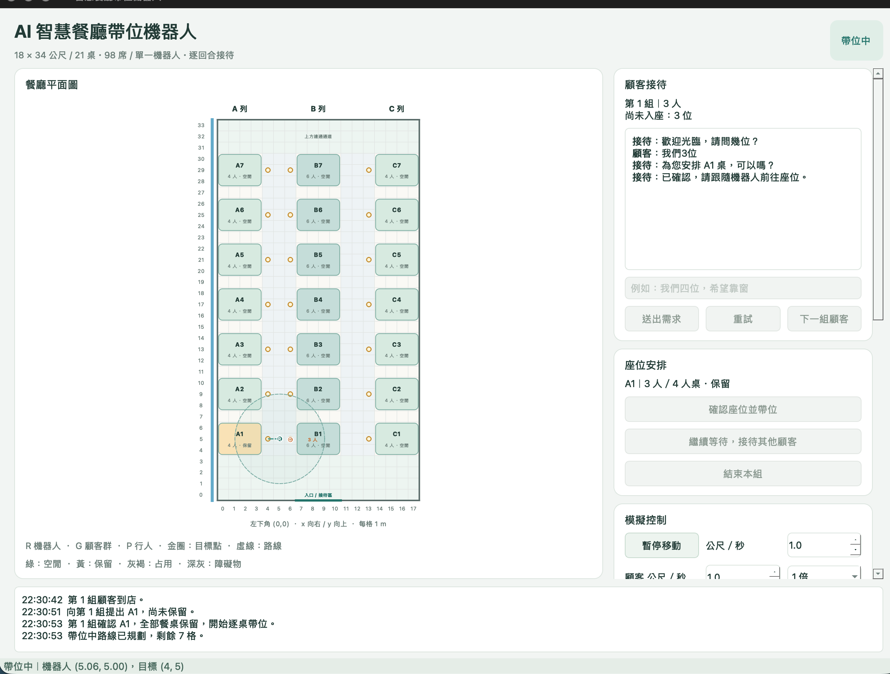

# AI 智慧餐廳帶位機器人

使用 Python 3.10 以上版本。以下指令都在 `hw3/` 目錄執行。

## 安裝

第一次建立環境：

```bash
python3 -m venv .venv
source .venv/bin/activate
python -m pip install -r requirements.txt
```

已建立環境時，只需 `source .venv/bin/activate`。依賴為 PySide6；Ollama HTTP 連接使用 Python 標準函式庫，無須安裝 Ollama Python SDK。

## 啟動完整模擬

在另一個終端啟動 Ollama：

```bash
OLLAMA_CONTEXT_LENGTH=16384 ollama serve
```

回到已啟用虛擬環境的 `hw3/` 終端：

```bash
python main.py
```

預設服務位址為 `http://localhost:11434`，模型為 `gpt-oss:120b-cloud`。可在介面中修改，或以 `OLLAMA_BASE_URL`、`OLLAMA_MODEL` 環境變數提供預設值。雲端模型需由使用者自行完成 Ollama 的連線／登入設定。

程式不會自動啟動 Ollama，也不會在開啟視窗時呼叫模型。模型僅在送出需求時被呼叫；單次 HTTP 請求逾時為 120 秒，需求 JSON 解析失敗時自動重試一次。失敗保留輸入，可修改連線設定後按「重試」。模型請求中若關閉視窗，會等目前請求結束後安全關閉。

## 使用流程

- 初始顧客在入口，以文字輸入需求，例如「我們五位」或「我們四位，希望靠窗」。未提座位偏好就直接安排，不額外詢問；只在人數不明、需求矛盾或特殊條件待釐清時追問。
- 接待以「為您安排 B1 桌，可以嗎？」或「為您安排 A1、A2，分 2 桌可以嗎？」提出座位；下方逐桌顯示人數與容量，例如 `B1｜5 人／6 人桌`。按「確認座位並帶位」後，整組方案的所有桌位一起轉為保留，機器人才開始移動。
- 不重複確認人數或無偏好，不在接待對話中說明按鈕操作，也不顯示入口距離、剩餘席位或「符合目前需求」。這些比較仍供內部分桌使用。
- 優先同列、桌號連續的桌位。只有分散位置或需要放寬偏好時，替代視窗最多列出 5 個最佳方案，標明每桌人數、相鄰／分散及偏好差異。接受後回到主介面確認，或選擇繼續等待。關閉替代視窗也視為繼續等待。
- 每組顧客只有一個 `G` 圖示，以獨立速度沿機器人 `R` 走過的路線跟隨。多桌帶位逐桌停靠，標籤顯示尚未入座的人數，例如 `8 人 → 4 人`；機器人抵達桌旁後等待顧客到達，再轉為占用；尚未到達的桌位維持保留。全部入座後顧客圖示移除，機器人才返回入口。
- 帶位與返回期間無法輸入新的接待需求。回到入口後可按「下一組顧客」。
- 選擇繼續等待的顧客會進入隊伍；有能安排整組的完整方案時，優先向最早到店且可安排的顧客提出座位，不先帶走部分顧客。前組沒有合適方案時，可先安排後組。新的分散／偏好替代方案仍須同意，已拒絕的方案不會自動重複提出；手動重新接待或更新需求後可再考慮。
- 等待隊伍只保存需求與順位；入口待命時可選取某組，按「接待選取的等待顧客／修改需求」補充或修改需求。
- 已占用餐桌可透過下拉選單釋放；保留中的餐桌不開放手動釋放。
- 可暫停／繼續整個模擬。機器人及顧客速度各為 0.5～1.5 公尺／秒，預設皆為 1；另提供 1、2、4 倍模擬速度，角色與等待計時同步加速。啟用障礙物編輯後，點擊空白格新增／移除障礙物；角色身體與機器人正在移動的區段禁止放置障礙。
- 機器人與顧客沿路線平滑移動，可停在兩格之間；速度單位為公尺／秒。A\* 仍以上下左右相鄰格規劃路線，轉彎維持直角。暫停保留當前位置，繼續時不跳格。
- 移動途中編輯障礙物時，機器人與顧客正在通過的區段端點禁止放置障礙；機器人完成當前安全區段後，從端點重新規劃路線；遇行人持續阻擋時，可安全退回上一個路點再繞行。
- 路線依機器人已感測的障礙規劃；完全無路時停下並保留任務，重新感測到變更後再嘗試。返回入口也採用相同規則。
- 只在出發前可按「結束本組」，讓顧客離開並結束本回合；模型處理中、帶位與返回期間不開放此操作。

## 具身智能模擬

- 顧客以獨立速度沿實際走過的路線跟隨，正常間距約 1 公尺。落後超過 2.5 公尺時機器人等候，縮短到 1.5 公尺後繼續。按「顧客停留」會立即讓機器人等待；可按「恢復跟隨」。
- 感測為 360 度、4 公尺半徑，首版不模擬視線遮蔽。餐桌與牆壁是已知地圖，臨時障礙物只有被感測後才供導航使用。已知障礙保留記憶，重新觀察到該位置為空才移除。
- 全圖供操作情境使用：深灰障礙與深紫行人為已發現，淺色為尚未發現；金框表示現場已移除但機器人仍記得的障礙。感測圈可能超出餐廳邊界。
- 行人起終點使用格子座標，例如 `4,8` → `6,8`。按「新增行人」產生 `P` 圖示，沿避開固定設施與現場障礙的路線移動，抵達後離場；可隨時清除。起點不得與角色重疊，無效座標或無路會記錄原因。
- 角色半徑皆為 0.25 公尺，移動會檢查身體與掃過區段，避免穿過設施或其他角色。前方行人距機器人外緣不足 1.5 公尺時減速到設定速度的 40%，不足 0.5 公尺時停止。
- 受阻持續 3 個模擬秒後嘗試繞行，無路則等候；10 秒後提示人工協助，保留原任務與桌位。此提示不會自動取消帶位。顧客停留或正常落後等候不計為路線受阻。
- 第一版保持四方向路線與直角轉向；不包含真實感測器、視線遮蔽、加減速物理或圓弧轉向。行人可能因互相阻擋而需要清除或人工介入。

## 多桌分配

- 超過六位可分坐多桌，直接提出具體方案，確認前不另問一次分桌意願。六位以下先找合適單桌，沒有合適單桌時也可提出分桌。
- 各桌人數盡量平均且不超過容量。例如八位分到六人桌與四人桌，各坐四位；十位分到兩張六人桌，各坐五位。
- 靠窗／非靠窗需求適用所有分配桌位。指定桌號表示方案須包含該桌；「一定」條件不會自動放寬。
- 說明「不要分桌」或「必須坐同一桌」後只安排單桌；尚未表態時允許提出多桌方案，仍須顧客確認才出發。
- 分配依序比較偏好、同列相鄰、桌數、剩餘座位與帶位路程，同分依桌號。組合搜尋按桌數分層並以容量剪枝，每類找到最少桌數後不搜尋更多桌。
- 停靠順序以 A\* 路徑距離最近的下一桌為優先，同分依桌號。每桌先分一人，再補給人數最少且尚有容量的桌位，同分依桌號。
- 確認時重新檢查完整方案的所有桌位與路線；任何一桌無法安排，就重新提出方案，不保留部分桌位。
- 暫時沒有空桌或路線被障礙物阻擋時可以等待；超過全場 98 席、拒絕分桌卻超過單桌容量，或必要條件的總席位不足時，說明原因並停用等待，可修改需求或結束本組。

桌子保持原位，不移動或拼接。尚未建模的特殊需求仍會先追問，不自動宣稱可滿足。

## 單獨查看靜態介面

```bash
python preview.py
```

`preview.py` 保留原樣，可獨立啟動，不需要 Ollama，也不依賴完整模擬的模組。

## 地圖與模組

地圖寬 18、高 34 格，每格 1 × 1 公尺，原點在左下角。A、B、C 各 7 桌；A／C 四人桌、B 六人桌，共 21 桌、98 席。A 列靠窗；金色圓圈是桌旁導航目標。地圖隨視窗等比例縮放。

| 檔案            | 職責                                           |
| --------------- | ---------------------------------------------- |
| `main.py`       | 完整模擬入口                                   |
| `gui.py`        | 地圖、對話及控制面板                           |
| `restaurant.py` | 幾何配置、顧客與各桌人數分配                   |
| `ai.py`         | Ollama 背景請求及需求解析                      |
| `seating.py`    | 單／多桌組合搜尋、平均分配、停靠順序與替代方案 |
| `navigation.py` | 可指定阻擋集合的四方向 A\*                     |
| `motion.py`     | 連續座標、角色半徑與移動區段碰撞判斷           |
| `simulation.py` | 回合、整組保留、逐桌入座、等待隊伍及狀態更新   |
| `preview.py`    | 獨立靜態預覽                                   |

正式模擬的 `restaurant.py` 集中定義桌位與地圖。餐桌矩形全部不可通行，繪製留白不改變阻擋範圍；導航目標點位於可通行格。所有狀態存在記憶體，關閉後不保存。

## 測試

測試指令、範圍及本次結果見 [tests/README.md](tests/README.md) 與 [tests/RESULTS.md](tests/RESULTS.md)。一般測試不連線；真實 Ollama 及原生視窗流程需另外明確執行。


