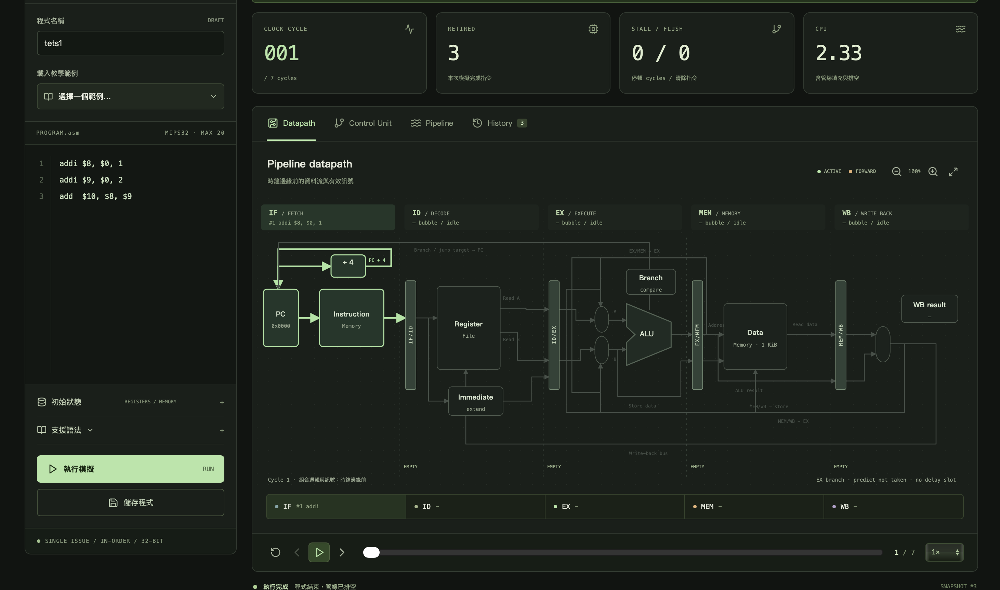
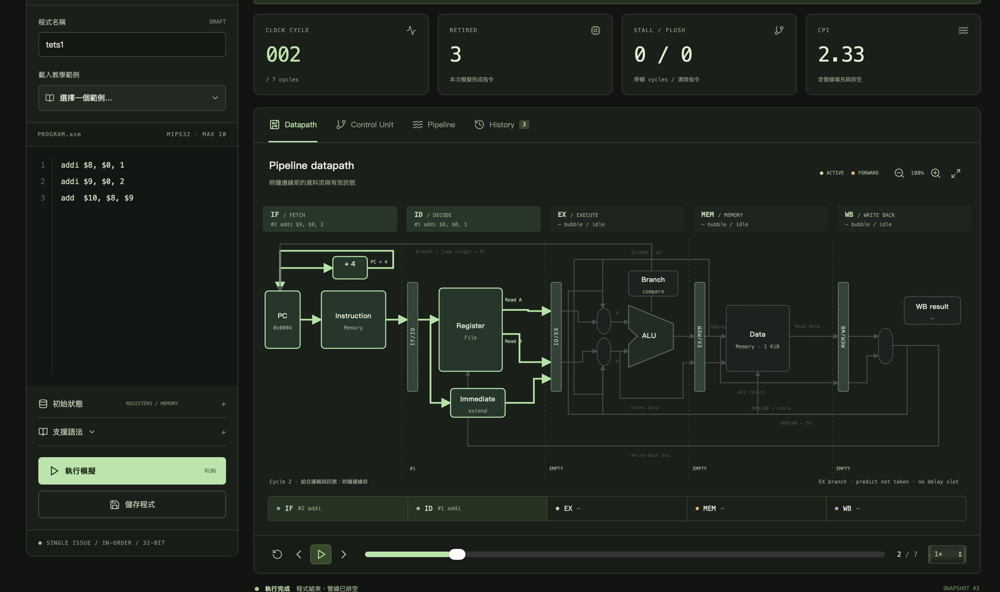
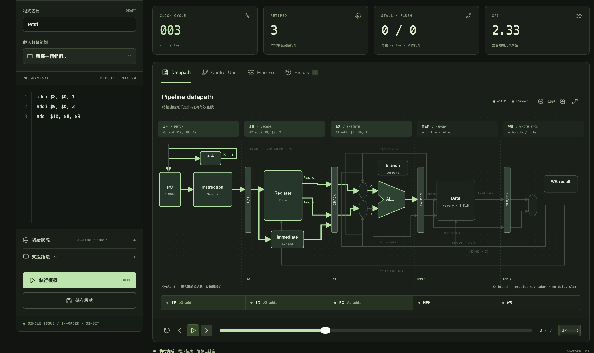
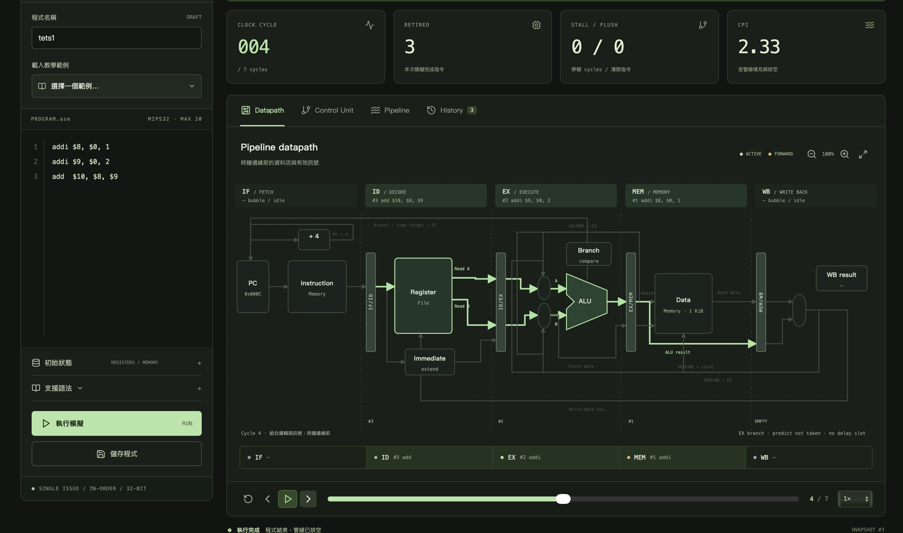
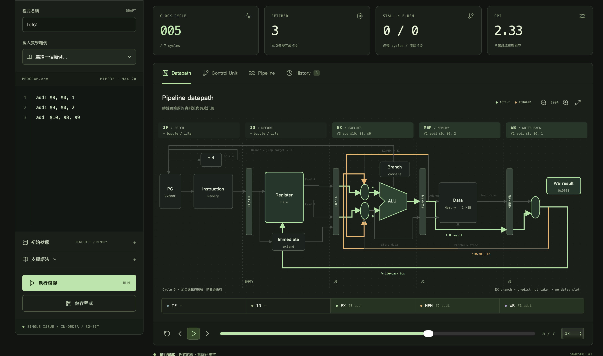
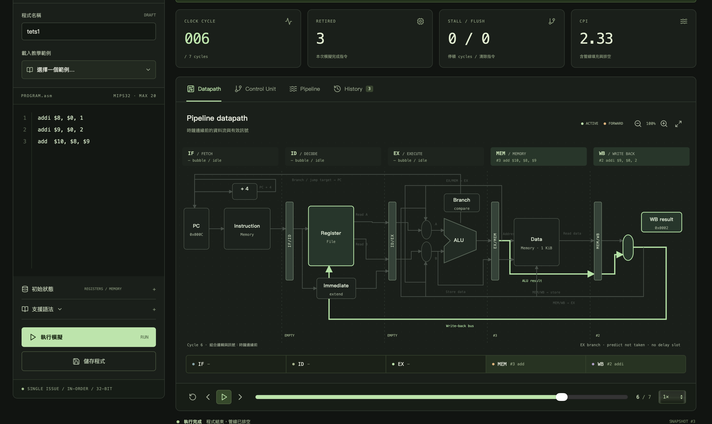
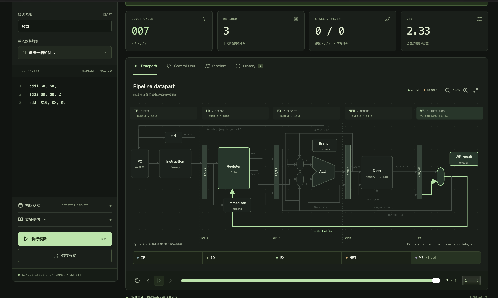

# MIPS / Pipeline Lab

MIPS 五級管線教學網站。使用者在瀏覽器撰寫 MIPS 組合語言、設定暫存器與記憶體初值，送到 **Rust** 後端組譯並模擬，再由 **React** 前端逐 cycle 呈現資料路徑、控制訊號、管線時序與機器狀態，清楚標示 forwarding、stall 與 flush 的發生原因。程式與每次模擬的完整快照都存進 **SQLite**，之後可以重新回放。專案附有單元、Web API 系統與無頭 Playwright E2E 三層自動化測試，全數通過。

## 測試

| 類型     | 範圍                       | 數量       | 結果     |
| -------- | -------------------------- | ---------- | -------- |
| 單元測試 | 組譯器、管線模擬核心       | 42 項      | 全數通過 |
| 系統測試 | Web API 與資料儲存         | 477 項檢查 | 全數通過 |
| E2E 測試 | 前後端完整操作流程         | 37 項      | 全數通過 |

在 `hw5` 目錄執行：

```bash
cargo test --test unit   # 單元測試
./tests/api/test.sh      # 系統測試（Web API）
./tests/e2e/test.sh      # E2E 測試（無頭 Playwright）
```

E2E 首次執行前需安裝相依套件與 Chromium。各項測試的涵蓋內容、環境需求與完整輸出見 [tests/README.md](tests/README.md)。

## 技術組成

| 項目       | 內容                                                                                               |
| ---------- | -------------------------------------------------------------------------------------------------- |
| 後端       | Rust（2021 edition）、[axum](https://docs.rs/axum) 0.8 與 tokio：提供 REST API，並在單一服務模式下提供前端靜態檔 |
| 模擬核心   | [`src/assembler.rs`](src/assembler.rs) 組譯與控制訊號、[`src/simulation.rs`](src/simulation.rs) 五級管線逐 cycle 模擬 |
| 資料庫     | SQLite，透過 [rusqlite](https://docs.rs/rusqlite)（bundled，不需另外安裝 SQLite），啟動時自動建表   |
| 前端       | React 19、TypeScript、Vite 6，圖示使用 lucide-react；資料路徑以 SVG 繪製                            |
| 測試       | Rust 單元測試、Bash + curl 的 Web API 系統測試、無頭 Playwright E2E 測試                           |

## 系統架構

開發模式（前後端分開啟動）：

```text
瀏覽器 http://127.0.0.1:5173
        │
        ▼
Vite dev server (:5173) ── React 前端
        │  /api、/health 由 proxy 轉送
        ▼
axum (:8080) ── 組譯器 → 管線模擬器
        │
        ▼
SQLite（mips.db）
```

單一服務模式：先建置前端，axum 會在同一個 port 同時提供 `frontend/dist` 的靜態檔與 API，打開 `http://127.0.0.1:8080` 即可使用。

## CPU 模型

採 Patterson & Hennessy 風格的五級、single-issue、in-order 32-bit MIPS 教學管線：

- **五級**：IF → ID → EX → MEM → WB。WB 寫回的值可在同一 cycle 的 ID 讀到。
- **分支與跳躍**：在 EX 判斷，採 predict not taken，沒有 delay slot。分支成立或跳躍時，清除 IF、ID 兩條年輕指令。
- **Forwarding**：EX/MEM → EX 與 MEM/WB → EX，EX/MEM 較新所以優先；目的暫存器為 `$zero` 時不轉送。`sw` 要寫入的資料可由 MEM/WB → MEM 提供。
- **Load-use stall**：`lw` 後緊接著使用其結果的指令會停頓一個 cycle（凍結 PC 與 IF/ID，ID/EX 插入 bubble）。分支比較來源、`jr` 目標與 `sw` 的 base 暫存器也適用此規則。
- **記憶體**：指令與資料記憶體分開，沒有結構衝突。資料記憶體 1024 bytes，little-endian，以 4-byte 對齊的 word 存取。
- **限制**：最多 20 條靜態指令（迴圈的動態執行次數不受此限）；cycle 上限可設 1–10000，預設 10000。
- **統計**：CPI = 已模擬 cycles ÷ 已 retired 指令數（包含管線填充、排空與 `nop`）。

## 功能

- **編輯程式**：內建 4 個教學範例（Forwarding & load-use、Branch & flush、Loop & dependencies、Jump & link）。
- **初始狀態**：每行一筆設定暫存器與記憶體初值，例如 `$t0 = 12`、`0x0000 = 7`，未設定的值為 0。
- **Datapath**：顯示時鐘邊緣前的資料流，有效路徑以綠色標示、forwarding 路徑以橘色標示，並可縮放與全螢幕檢視。
- **Control Unit**：各指令的控制訊號隨管線暫存器傳遞，EX 階段顯示 forwarding 的選擇。
- **Pipeline**：管線時序表，每行是一個動態指令實例；以 `·` 標示 stall、`×` 標示 flush。
- **機器狀態**：可切換時鐘邊緣前與邊緣後的暫存器、記憶體內容，本 cycle 有變更的值以綠底標示。
- **播放控制**：逐 cycle 前進或後退、自動播放、調整播放速度，並可拖曳時間軸定位。
- **History**：每次執行模擬都會自動保存快照，可重新載入回放或刪除；程式可另外儲存、載入與刪除。

## 支援指令

```text
add addu sub subu addi addiu
and or xor nor andi ori xori
slt sltu slti sltiu sll srl sra lui
lw sw beq bne j jal jr nop
```

- 暫存器可寫成名稱（`$t0`）或編號（`$8`）。
- 支援標籤、十進位與十六進位，以及 `#`、`;` 註解。
- 分支的數字立即值為相對 word offset；`j` 的數字為絕對 byte 位址。
- 除 `nop` 外不支援偽指令；資料由初始狀態設定，不支援 `.data`。

## API

所有 API 都在 `/api/v1` 之下，錯誤時回傳 `{ "error": "..." }`。

| 方法     | 路徑                       | 說明                                                                                   |
| -------- | -------------------------- | -------------------------------------------------------------------------------------- |
| `GET`    | `/health`                  | 健康檢查，回傳 `OK`                                                                    |
| `GET`    | `/api/v1/programs`         | 列出已儲存程式（最近更新的在前，最多 100 筆）                                          |
| `POST`   | `/api/v1/programs`         | 新增程式（body：`{ "title": "...", "input": {...} }`）                                 |
| `GET`    | `/api/v1/programs/:id`     | 取得單一程式                                                                           |
| `PUT`    | `/api/v1/programs/:id`     | 更新程式名稱與內容                                                                     |
| `DELETE` | `/api/v1/programs/:id`     | 刪除程式，已存的模擬快照會保留                                                         |
| `GET`    | `/api/v1/simulations`      | 列出模擬紀錄摘要（最新的在前，最多 100 筆）                                            |
| `POST`   | `/api/v1/simulations`      | 執行模擬並保存快照（body：`{ "title": "...", "program_id": 1 \| null, "input": {...} }`） |
| `GET`    | `/api/v1/simulations/:id`  | 取得完整快照，包含每個 cycle 的 trace                                                  |
| `DELETE` | `/api/v1/simulations/:id`  | 刪除模擬紀錄                                                                           |

`input` 的格式：

```json
{
  "source": "addi $t0, $zero, 1",
  "registers": { "9": 5 },
  "memory": { "0": 7 },
  "max_cycles": 10000
}
```

`registers` 的 key 是暫存器編號（0–31），`memory` 的 key 是 byte 位址（0–1020，4-byte 對齊），值都是 32-bit word。

驗證規則：名稱 1–100 字、程式文字最多 256 KiB、request body 最多 512 KiB；組譯錯誤或初始設定不合法時回傳 400，且不新增紀錄。模擬結束狀態（`status`）分為 `completed`（程式執行完、管線已排空）、`error`（執行期錯誤，例如跳到無效位址）、`limit`（達到 cycle 上限），三種都會保存。

## 資料庫

啟動時自動建立（`CREATE TABLE IF NOT EXISTS`），啟用 WAL 與外鍵檢查。

### `programs`

| 欄位         | 說明                                              |
| ------------ | ------------------------------------------------- |
| `id`         | 主鍵                                              |
| `title`      | 程式名稱                                          |
| `input`      | 程式原始碼、暫存器與記憶體初值、cycle 上限（JSON） |
| `updated_at` | 最後更新時間（Unix 秒）                           |

### `runs`

| 欄位                 | 說明                                                                     |
| -------------------- | ------------------------------------------------------------------------ |
| `id`                 | 主鍵                                                                     |
| `title`              | 紀錄名稱                                                                 |
| `program_id`         | 來源程式；刪除程式時設為 `NULL`（`ON DELETE SET NULL`），快照本身保留    |
| `result`             | 完整模擬結果（JSON），包含組譯後指令、每個 cycle 的 trace 與統計         |
| `status`             | `completed`、`error` 或 `limit`                                          |
| `cycles` / `retired` | 模擬 cycles 與完成指令數，供清單顯示摘要                                 |
| `created_at`         | 建立時間（Unix 秒）                                                      |

快照保存的是當時的完整結果，之後修改原程式不會影響已存的快照。

## 專案結構

```text
hw5/
├── Cargo.toml
├── src/
│   ├── main.rs            # axum 伺服器：API、SQLite、前端靜態檔
│   ├── lib.rs
│   ├── assembler.rs       # 組譯器：解析語法、標籤、機器碼與控制訊號
│   └── simulation.rs      # 五級管線模擬：hazard、forwarding、stall、flush 與 trace
├── frontend/
│   ├── vite.config.ts     # 開發用 port 5173，/api 轉送到 8080
│   └── src/
│       ├── App.tsx        # 編輯器、分頁、播放控制與歷史紀錄
│       ├── Datapath.tsx   # SVG 管線資料路徑
│       ├── examples.ts    # 教學範例
│       ├── types.ts       # 與後端對應的資料型別
│       └── style.css
├── tests/                 # 單元、系統（API）與 E2E 測試
└── hw5-pic/               # README 截圖
```

## 使用方式

### 1. 準備

- Rust stable 與 Cargo。
- Node.js 20.19+ 或 22.12+ 與 npm。

### 2. 開發模式

在 `hw5` 目錄啟動後端：

```bash
cargo run
```

另一個終端啟動前端：

```bash
cd frontend
npm install
npm run dev
```

打開 http://127.0.0.1:5173。

### 3. 單一服務模式

先建置前端，再由後端一起提供：

```bash
npm --prefix frontend install
npm --prefix frontend run build
cargo run --release
```

打開 http://127.0.0.1:8080。後端以相對路徑讀取 `frontend/dist`，請在 `hw5` 目錄執行。

### 環境變數

| 變數            | 預設值           | 說明              |
| --------------- | ---------------- | ----------------- |
| `SERVER_ADDR`   | `127.0.0.1:8080` | 後端監聽位址      |
| `DATABASE_PATH` | `mips.db`        | SQLite 資料庫檔案 |

例如：

```bash
SERVER_ADDR=127.0.0.1:9000 DATABASE_PATH=/tmp/lab.db cargo run
```

改了後端 port 時，開發模式的 proxy 目標在 [`frontend/vite.config.ts`](frontend/vite.config.ts) 也要一起改。

## 畫面展示

以下截圖展示這三條指令在 Cycle 1–7 的管線資料路徑：

```asm
addi $8, $0, 1    # $8 = 1
addi $9, $0, 2    # $9 = 2
add  $10, $8, $9  # $10 = 3
```

第 3 條 `add` 同時依賴前兩條的結果，但兩個值都能靠 forwarding 及時取得，所以整段程式沒有 stall，共 7 cycles、3 條指令，CPI = 7 ÷ 3 ≈ 2.33。

### Cycle 1

`#1 addi $8` 進入 IF。PC 為 `0x0000`，從指令記憶體取指，同時算出 PC + 4。其餘階段都是 bubble。



### Cycle 2

`#1` 進入 ID 讀取暫存器並做立即值符號延伸；`#2 addi $9` 進入 IF。



### Cycle 3

管線依序前進：`#1` 在 EX 由 ALU 計算 `0 + 1`，`#2` 在 ID，`#3 add` 在 IF。這是最後一條指令，之後停止取指。



### Cycle 4

`#1` 進入 MEM（`addi` 不存取記憶體，ALU 結果直接往 MEM/WB 傳），`#2` 在 EX 計算 `0 + 2`，`#3` 在 ID 讀取 `$8`、`$9`。此時兩者都還沒寫回，讀到的是舊值 0。IF 已沒有指令，開始排空。



### Cycle 5

本例的重點。`#3 add` 進入 EX，兩個運算元都改用 forwarding（橘色路徑）：

- `$9` 來自 MEM 階段的 `#2`，走 **EX/MEM → EX**。
- `$8` 來自 WB 階段的 `#1`，走 **MEM/WB → EX**。

同一時間，`#1` 在 WB 把 `$8 = 1` 寫回暫存器檔。



### Cycle 6

`#2` 在 WB 寫回 `$9 = 2`；`#3` 進入 MEM，帶著 ALU 結果 3 往 MEM/WB 前進。



### Cycle 7

`#3` 在 WB 寫回 `$10 = 3`，管線完全排空，模擬結束（狀態為「執行完成」）。


