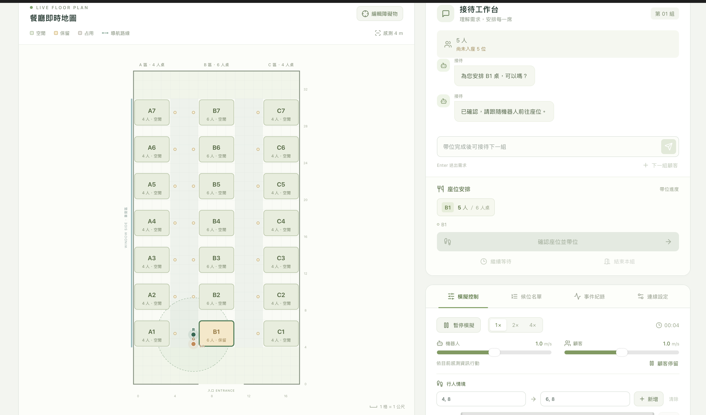

# 席間 · AI 餐廳帶位控制台

`hw3` 的獨立網頁版本。React + TypeScript + Vite，使用 SVG 呈現俯視地圖；分桌、候位、A\*、感測、碰撞與連續移動全部在瀏覽器內計算，不依賴 Python。

以桌機／筆電使用為主，建議視窗寬度至少 1060 px。所有指令在 `hw6/` 執行。

## 安裝與啟動

需要 Node.js 22.12 以上版本與 npm。

```bash
cd hw6
npm install
npm run dev
```

本機網址固定為 `http://127.0.0.1:6060`，與其他作業的連接埠分開。若 6060 已被占用，會直接報錯，不自動切換連接埠。

另外自行啟動 Ollama：

```bash
OLLAMA_CONTEXT_LENGTH=16384 ollama serve
```

預設服務 `http://localhost:11434`、模型 `gpt-oss:120b-cloud`。雲端模型需要自行完成 Ollama 登入與連線設定；也可改用已安裝且能遵循接待 JSON 格式的模型。

開啟頁面會自動查詢 Ollama 模型清單，不會生成回答，也不會啟動 Ollama。在「連線設定」的模型下拉選單切換模型，下一筆需求使用新選擇，並保留本組對話、已確認需求、座位方案與模擬進度。

- 選單只提供 Ollama 實際回傳的模型，不能手動輸入名稱。預設模型在清單中時自動選用；不在清單中則提示選擇，不會自動改用其他模型。
- 修改服務位址會清除舊清單與模型選擇，需按「載入模型」取得新服務清單，再選擇模型。
- 可按「重新載入」更新清單；同一服務中先前選擇仍存在時會保留。清單查詢最多五秒，連線失敗或沒有模型時會顯示原因，未選到有效模型時無法送出或重試需求。
- AI 請求期間不能修改位址、切換模型或重新載入清單。同一次請求的 JSON 格式重試使用相同模型。
- 選擇會延續至下一組顧客，重新整理頁面才回到預設設定。雲端模型需先在 Ollama 完成登入。

服務位址與模型可直接在「連線設定」調整，設定只留在當次頁面。

## 建置與本機執行

```bash
npm run build
npm start
```

`build` 執行 TypeScript 型別檢查並產生 `dist/`；`start` 使用 Vite 的本機 preview 服務，網址同樣固定為 `http://127.0.0.1:6060`。這是本機展示用途，與開發服務擇一執行。

修改連接埠設定後，若服務原本正在執行，需停止並重新啟動才會套用。

開發與 preview 共用本機代理：`POST /api/ollama/models` 接收 `{ baseUrl }`，查詢 Ollama `/api/tags` 並回傳 `{ models: string[] }`；`POST /api/ollama/chat` 在每次送出前重新確認模型仍在清單，再轉送到 `/api/chat`。模型已移除時會保留需求輸入，提示重新載入清單。瀏覽器不需直接跨來源連接 Ollama。請使用上述本機服務，直接開啟 `dist/index.html` 或只提供靜態檔案會缺少代理。

獨立型別檢查指令：

```bash
npm run typecheck
```

## 接待與座位

- 初始顧客位於入口，輸入「我們五位」或「我們四位，希望靠窗」。未提偏好直接安排，只在人數、矛盾或特殊條件待釐清時追問。
- AI 負責需求理解，實際桌位由分桌引擎決定。模型清單確認最多五秒，接著生成回答最多 120 秒，前端單次等待上限為 130 秒；需求 JSON 解析失敗自動重試一次，連線失敗則保留輸入供手動重試。
- 提出方案時不保留桌位；「確認座位並帶位」會重新檢查所有桌位與路線，整組保留後才出發。任一桌失效就重新提出方案，不保留部分桌位。
- 分桌人數盡量平均、不超過容量；優先符合偏好、同列連續桌位，再比較桌數、空餘容量與路程。超過六位可分桌，六位以下沒有單桌時也可提出分桌；明確拒絕分桌則只找單桌。
- 靠窗條件適用所有分配餐桌；指定桌號表示方案須包含該桌。明確表示「必須」的條件不會自動放寬。
- 分散或放寬偏好的替代方案最多五個，顯示每桌人數與差異。選定後回工作台確認；關閉視窗、按 Escape 或點背景等同繼續等待。
- 多桌依最近導航路程逐桌停靠。顧客沿機器人實際走過的路線跟隨，到桌旁才將該桌轉為占用；未到達的桌位保持保留。全部入座後，機器人返回入口。
- 候位保存需求與順位；入口待命時，優先接待最早到店且能安排整組的顧客。前組無方案可先接待後組；已拒絕的方案不會自動反覆提出，手動接待或更新需求後可重新考慮。
- 「候位名單」可接待指定組別並修改需求。帶位、返回與 AI 請求期間不能接待新需求；「結束本組」僅限出發前使用。
- 可手動釋放已占用餐桌，保留中的餐桌不能釋放。永久容量不足的需求會說明原因並停用等待，可修改需求或結束本組。

## 模擬與地圖

- 地圖 18 × 34 格，每格 1 公尺，原點左下角；A／B／C 各七桌，A／C 四人桌、B 六人桌，共 21 桌、98 席，A 區靠窗。桌子固定，不移動或拼接。
- 機器人 `R`、顧客組 `G`、行人 `P` 皆有 0.25 公尺身體半徑；路線為四方向 A\*，沿直角路線平滑移動，不含真實感測器、遮蔽、加減速物理或圓弧轉向。
- 360 度感測半徑 4 公尺；餐桌為已知設施，臨時障礙物只有被感測後才加入導航。記憶會保留，重新觀察該處為空時才移除。
- 深色障礙與行人表示已發現、淺色表示未發現、金框表示現場已移除但仍留在機器人記憶中。
- 啟用「編輯障礙物」後點選空白格新增／移除，也可用方向鍵移動游標、Enter 或空白鍵切換、Escape 結束編輯。角色身體與正在通過的區段受到保護。
- 機器人正常與顧客保持約 1 公尺；落後超過 2.5 公尺時等候，縮短到 1.5 公尺再繼續。「顧客停留」與「恢復跟隨」可控制顧客。
- 前方行人外緣距離不足 1.5 公尺時減速為設定速度的 40%，不足 0.5 公尺停止。持續受阻三個模擬秒嘗試繞行，十秒提示人工協助，保留任務與桌位。
- 行人起終點使用整數格子座標，例如 `4,8` → `6,8`；抵達離場，亦可清除。無效座標、角色重疊或沒有路線時，原因顯示於「事件紀錄」。行人互相阻擋時可能需要清除或人工介入。
- 機器人與顧客速度各 0.5～1.5 公尺／秒，預設 1；提供 1／2／4 倍速與暫停。頁面移到背景不累積待補跑時間，回到頁面不跳位置。
- 無路時停下保留任務，重新感測到變更後再規劃。事件紀錄最多保留 150 筆。

資料全部保存在記憶體；重新整理即重置。沒有帳號、資料庫、多人共用狀態或雲端部署。

## 程式結構

| 位置                                  | 職責                                   |
| ------------------------------------- | -------------------------------------- |
| `src/core/restaurant.ts`              | 地圖、桌位、需求、顧客與角色資料       |
| `src/core/seating.ts`                 | 分桌搜尋、排序、替代方案與整組重新檢查 |
| `src/core/navigation.ts`、`motion.ts` | A\*、連續座標、身體與移動碰撞          |
| `src/core/simulation.ts`              | 接待、候位、帶位、感測與避障狀態機     |
| `src/core/ai.ts`、`prompt.ts`         | Ollama 接待提示、請求、重試與解析      |
| `src/components/RestaurantMap.tsx`    | SVG 地圖與障礙物編輯                   |
| `src/App.tsx`、`useSimulation.ts`     | 工作台、管理面板與動畫生命週期         |
| `src/useOllamaModels.ts`              | 應用層的模型清單、選擇與載入狀態       |
| `server/ollamaProxy.ts`               | 開發及本機 preview 共用的 Ollama 代理  |

## 測試圖


